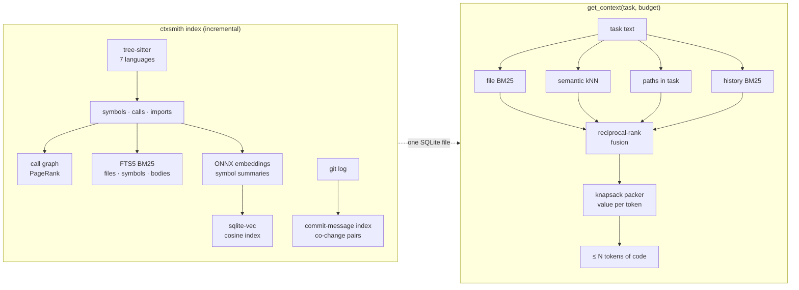

<!-- mcp-name: io.github.RahulSankhla312/contextsmith -->
<div align="center">

# ContextSmith

### Give your coding agent the right code, not more code.

A local context engine for Claude Code, Cursor, Codex and any MCP agent. It indexes your
repository into a code graph, hybrid search and git history, and answers every task with
the code that matters, packed into a token budget you choose.

[](https://github.com/RahulSankhla312/contextsmith/actions/workflows/ci.yml)
[](https://pypi.org/project/contextsmith/)
[](https://github.com/RahulSankhla312/contextsmith/blob/main/pyproject.toml)
[](https://github.com/RahulSankhla312/contextsmith/blob/main/LICENSE)


</div>

Coding agents spend their context window on the wrong code. They grep, open whole files,
and run out of room before they reach the function that needs the fix, and you pay for
every token they read. ContextSmith answers one question as well as possible: **given this
task and N tokens, what code should the agent read?**

<table>
<tr>
<td align="center"><b>92%</b><br>of real bug fixes had the right file inside a 4,000-token context<br><sub>vs 29% for search + whole files</sub></td>
<td align="center"><b>1.7x</b><br>more often the exact lines to change are shown<br><sub>48% vs 29%, same budget</sub></td>
<td align="center"><b>100% local</b><br>no API keys, no cloud,<br>code never leaves the machine</td>
</tr>
</table>

<sub>Measured on 114 Django issues from SWE-bench Lite that no tuning step ever saw. <a href="#results">Method and full results</a>.</sub>

## Quickstart (60 seconds)

```bash
pipx install "contextsmith[semantic]"      # or: pip install "contextsmith[semantic]"
cd your-repo
ctxsmith index                              # once; afterwards only changed files are re-read
ctxsmith context "Coupons are applied twice at checkout" --budget 4000
```

Connect it to your agent (the command prints the exact line for your machine):

```bash
ctxsmith mcp-config claude    # or: cursor, windsurf, codex
claude mcp add contextsmith -- ctxsmith serve --path /path/to/your-repo
```

From then on the agent calls `get_context` itself and gets ranked, budgeted code instead of
grepping. Without the `[semantic]` extra everything still works, using keyword search only.

## Who it's for

### Developers

- **Faster, better agent sessions on big repos.** The agent starts from the right functions
  instead of exploring; fewer wrong edits and "I couldn't find it" loops.
- **Understand unfamiliar code.** `ctxsmith context "where are payment retries handled?"`
  returns the relevant functions with their file and line numbers.
- **Change safely.** `ctxsmith impact charge_card` lists everything that calls it,
  transitively: what a change could break, before you make it.
- **Remember the gotchas.** `ctxsmith note add "never call without the account lock" --symbol
  charge_card` pins a note to the code; it shows up in every future context for that code,
  for you and for the agent.

### Teams and companies

| Need | How ContextSmith covers it |
|---|---|
| **Code that must not leave the building** (finance, health, government, enterprise IP) | Runs entirely on the developer's machine. Parsing, search and embeddings are local; the only network use is a one-time download of two small open models, which you can mirror internally for air-gapped machines |
| **Predictable AI spend** | Every answer has a hard token budget you set, so context cost per task is fixed instead of "whatever the agent opened" |
| **Works with the agents you already pay for** | Standard MCP server: Claude Code, Cursor, Windsurf, Codex, Copilot agents and in-house agents use the same index |
| **Onboarding** | New engineers and their agents ask questions in plain language and land on the right code |
| **Code review and CI** | `ctxsmith context "$PR_TITLE" -b 6000` gives a review bot the code a PR touches and depends on; `ctxsmith impact NAME` shows the blast radius |
| **Team knowledge** | Decisions and invariants live next to the code as notes, not in someone's head |
| **No lock-in, no procurement** | MIT licence (commercial use is fine), a single SQLite file per repository, no server to run, no account |

Typical rollout: each developer installs it with `pipx`, runs `ctxsmith index` in the
repositories they work on, and adds one MCP line to their agent. There is nothing to host.
See [Using it at a company](#using-it-at-a-company) for CI and offline setups.

### Builders of AI tools

ContextSmith is also a Python library. Use it as the retrieval layer of your own agent,
review bot or internal assistant:

```python
from contextsmith import Engine

eng = Engine("path/to/repo")
eng.index()
pack = eng.context("Fix the race when two users book the last seat", budget=6000)
prompt = f"{pack.text}\n\nTask: fix the race when two users book the last seat."
```

## Results

The test: take a real GitHub issue from [SWE-bench Lite](https://www.swebench.com/), check the
repository out at the issue's own commit (so no future code or history leaks in), give the
issue text to the tool, and check whether the code the real fix changed comes back.

**Final test on Django: 114 issues that no tuning step ever saw.**

| | BM25, whole files | **ContextSmith** |
|---|---|---|
| The fix's file is ranked 1st / in the top 3 / top 5 | 50.9% / 70.2% / 77.2% | **51.8% / 79.8% / 85.1%** |
| The fix's file is inside a **4,000-token** context | 28.9% | **92.1%** (3.2x) |
| The **exact lines the fix changes** are shown in 4,000 tokens | 28.9% | **48.1%** (1.7x) |
| Query time (median, laptop CPU, 2,800-file repository) | 145 ms | 238 ms |

The baseline pastes BM25-ranked files whole until the budget runs out, which is what
"search the repo and open files" agents do. ContextSmith spends the same tokens on the
functions that matter and outlines of the rest, so the right file almost always makes it in.

<details>
<summary>All strategies and ablations</summary>

| strategy | R@1 | R@3 | R@5 | R@10 | file in 4k | file in 8k | lines in 4k | lines in 8k | ms |
|---|---|---|---|---|---|---|---|---|---|
| BM25, whole files | 50.9 | 70.2 | 77.2 | 84.2 | 28.9 | 49.1 | 28.9 | 49.1 | 145 |
| lexical (no embeddings) | 48.2 | 74.6 | 78.9 | 86.0 | 86.0 | 89.5 | 42.3 | 46.2 | 145 |
| embeddings only | 48.2 | 69.3 | 78.9 | 86.8 | – | – | – | – | 249 |
| **ContextSmith (default)** | **51.8** | **79.8** | **85.1** | 88.6 | **92.1** | **96.5** | **48.1** | **50.7** | 238 |
| + cross-encoder re-rank | 34.2 | 73.7 | 81.6 | 91.2 | – | – | – | – | 1824 |
| without git history | 56.1 | 78.9 | 84.2 | 90.4 | – | – | – | – | 249 |

Full numbers: [bench/results-django/summary.md](https://github.com/RahulSankhla312/contextsmith/blob/main/bench/results-django/summary.md).

</details>

What the ablations say, including what didn't work:
- **Embeddings earn their place:** adding them to the lexical ranker lifts top-5 from 79% to
  85% and exact-line coverage from 42% to 48%.
- **The cross-encoder re-rank hurts** the top result (52% → 34%) at 8x the latency, so it is
  off by default and marked experimental. A general web-search re-ranker doesn't understand
  issue-to-code relevance; a code-trained one is on the roadmap.
- **Git commit history is mixed:** it helped on the tuning repositories, but on Django
  removing it *raises* recall@1 by 4 points. It stays on because the default was fixed before
  the Django run; changing it now would be tuning on the test set.
- At 8,000 tokens whole files catch up on exact lines (49% vs 51%): every Django fix here
  touches one file, and at that budget it often fits whole.

**Method.** Weights were chosen by grid search on 89 issues from 8 other repositories
(pytest, requests, flask, sphinx, pylint, xarray, astropy, seaborn) with
[`bench/tune.py`](https://github.com/RahulSankhla312/contextsmith/blob/main/bench/tune.py) and
[`bench/tune_pack.py`](https://github.com/RahulSankhla312/contextsmith/blob/main/bench/tune_pack.py),
then frozen before Django was run once. Reproduce it with
`ctxsmith bench --repos django/django` (first run: about two hours on a laptop).

## How it works



**One SQLite file per repository** holds everything: files, symbols, call and import edges,
three FTS5 indexes, git statistics, team notes, and the vector index (a `vec0` virtual table
from [sqlite-vec](https://github.com/asg017/sqlite-vec); a numpy fallback runs where SQLite
can't load extensions).

**Retrieval (RAG).** Each signal produces its own ranked list of files; reciprocal-rank fusion
combines them, so no single noisy signal dominates:

| Signal | What it catches |
|---|---|
| BM25 over whole files (`camelCase`/`snake_case` split, paths weighted up) | exact vocabulary |
| Semantic kNN over symbol summaries (`BAAI/bge-small-en-v1.5`, ONNX, CPU) | the same idea in different words |
| Paths named in the task (tracebacks, "in `foo/bar.py`") | explicit pointers |
| BM25 over each file's commit messages | "this was touched for a similar bug before" |
| Co-change, call-graph neighbours, PageRank, exact-name mentions | available as weights; off by default because the benchmark showed they hurt *file* ranking |

The weights come from a grid search (`bench/tune.py`) on 89 SWE-bench Lite issues from 8
repositories and were then checked on Django, which tuning never saw.

**What gets embedded, and why.** Not whole files and not raw chunks: one short summary per
function or class — path, qualified name, signature, first docstring sentence. On a laptop
CPU this is ~30x cheaper than embedding bodies, and it is what identifies "which function is
this about". Vectors are cached by content hash, so a function that didn't change is never
embedded twice — across re-indexes and across git checkouts. Test files are skipped.

**Experimental re-rank.** `ctxsmith context --rerank` re-scores the top 20 files with a
cross-encoder (`ms-marco-MiniLM-L-6-v2`). It is off by default because the benchmark shows it
hurts (see Results).

**Packing.** Candidates are function bodies (matched by name, docstring and body text),
class outlines and file outlines. A greedy knapsack takes the best value per token,
discounts repeats from one file, and enforces the budget on the final rendered text, so the
answer is never over budget.

**Always fresh.** Re-indexing compares file size and mtime before reading anything and only
re-parses and re-embeds what changed; checking an unchanged 2,800-file repository takes about
half a second. The MCP server does this before answering (at most every 2 seconds), so the
agent never reads code it has just edited from a stale index.

## Use it from your agent (MCP)

`ctxsmith mcp-config <client>` prints the exact snippet for your machine.

**Claude Code**

```bash
claude mcp add contextsmith -- ctxsmith serve --path /path/to/repo
```

**Cursor, Windsurf and other clients** (`mcp.json`):

```json
{
  "mcpServers": {
    "contextsmith": { "command": "ctxsmith", "args": ["serve", "--path", "/path/to/repo"] }
  }
}
```

**Codex** (`~/.codex/config.toml`):

```toml
[mcp_servers.contextsmith]
command = "ctxsmith"
args = ["serve", "--path", "/path/to/repo"]
```

| Tool | Returns |
|---|---|
| `get_context(task, budget_tokens)` | the best code for the task, packed to the budget |
| `search(query)` | ranked functions and classes |
| `find_symbol(name)` | where something is defined |
| `callers(name)` / `callees(name)` | one hop of the call graph |
| `impact(name)` | everything that transitively calls it: what a change could break |
| `related_files(path)` | files linked by code, and files that change together in git |
| `add_note(text, path, symbol)` | a decision or gotcha that later sessions should know |
| `overview()` | languages, size, central and most-changed files |
| `reindex()` | force an incremental re-index |

## CLI

| Command | What it does |
|---|---|
| `ctxsmith index [PATH] [--no-semantic]` | Index; incremental, embeddings on when the extra is installed |
| `ctxsmith context "task" -b 4000` | Best context within a token budget |
| `ctxsmith rank "task"` | Ranked files, with the signals that found each |
| `ctxsmith search "query"` | Ranked functions and classes |
| `ctxsmith symbol / callers / callees NAME` | Navigate the call graph (`--json` for scripts) |
| `ctxsmith impact NAME` | What could break if NAME changes |
| `ctxsmith related FILE` | Files linked by code, and files that change together |
| `ctxsmith note add "text" --file F` | Remember a decision or gotcha |
| `ctxsmith overview` | Languages, size, central and most-changed files, semantic status |
| `ctxsmith serve` | MCP server over stdio |
| `ctxsmith mcp-config [claude\|cursor\|codex]` | Setup snippet for your agent |
| `ctxsmith bench --repos django/django` | Run the SWE-bench Lite benchmark yourself |

## Python API

```python
from contextsmith import Engine

eng = Engine("path/to/repo")       # index stored in path/to/repo/.contextsmith/
eng.index()                        # incremental; returns counts and timings
pack = eng.context("Fix the race when two users book the last seat", budget=6000)
pack.text, pack.tokens, pack.files, pack.spans   # markdown, size, files, line ranges shown

eng.rank("seat double-booked").files  # ranked files, with the signals that found each
eng.search("seat reservation")     # ranked functions and classes
eng.impact("reserve_seat")         # transitive callers
eng.related_files("booking/models.py")
eng.add_note("Seats are locked per show, not per seat", path="booking/models.py")
```

## Configuration

| Variable | Default |
|---|---|
| `CTXSMITH_EMBED_MODEL` | `BAAI/bge-small-en-v1.5` (any [fastembed](https://github.com/qdrant/fastembed) text model, e.g. `jinaai/jina-embeddings-v2-base-code`) |
| `CTXSMITH_RERANK_MODEL` | `Xenova/ms-marco-MiniLM-L-6-v2` |
| `FASTEMBED_CACHE_PATH` | `~/.cache/contextsmith/models` |

The index lives in `<repo>/.contextsmith/` (git-ignored automatically). Without the
`semantic` extra everything still works, lexically.

## Using it at a company

**Per developer (the usual rollout).** `pipx install "contextsmith[semantic]"`, then
`ctxsmith index` in each repository and one `ctxsmith mcp-config` line per agent. Nothing to
host, no accounts, no shared service to secure.

**In CI: give a review bot the code a pull request is about.**

```yaml
# .github/workflows/pr-context.yml
name: PR context
on: pull_request
jobs:
  context:
    runs-on: ubuntu-latest
    steps:
      - uses: actions/checkout@v4
        with: { fetch-depth: 0 }            # full history powers the git signals
      - uses: actions/setup-python@v5
        with: { python-version: "3.12" }
      - uses: actions/cache@v4               # reuse the index and the model between runs
        with:
          path: |
            .contextsmith
            ~/.cache/contextsmith/models
          key: contextsmith-${{ github.base_ref }}
      - run: pip install "contextsmith[semantic]" && ctxsmith index
      - run: ctxsmith context "$TITLE" --budget 6000 > pr-context.md
        env:
          TITLE: ${{ github.event.pull_request.title }}   # via env, never inline: no injection
      - uses: actions/upload-artifact@v4
        with: { name: pr-context, path: pr-context.md }
```

Feed `pr-context.md` to whichever review model you use, or post `ctxsmith impact <function>`
output as a comment so reviewers see the blast radius.

**Offline and air-gapped machines.**

```bash
# on a machine with internet access (same OS and Python version as the target)
pip download "contextsmith[semantic]" -d wheels
ctxsmith index                     # downloads the embedding model (65 MB) once
# copy wheels/ and ~/.cache/contextsmith/models/ across, then on the offline machine:
pip install --no-index --find-links wheels "contextsmith[semantic]"
export HF_HUB_OFFLINE=1            # never try the network again
```

**What is stored, and where.** One SQLite file per repository in `<repo>/.contextsmith/`:
symbols, search indexes, call graph, git statistics and commit messages, notes, and
embedding vectors. It is git-ignored automatically and never uploaded anywhere. ContextSmith
has no telemetry; the only downloads are the open embedding model from Hugging Face on first
use (none without the `semantic` extra) and, if you run `ctxsmith bench`, the public benchmark.

## FAQ

**Does my code leave my machine?** No. Parsing, search, embeddings and the MCP server all
run locally. Your agent still sends the context it receives to its own model provider, as it
would with any file it reads; ContextSmith just makes that context smaller and more relevant.

**How big a repository can it handle?** Measured on Django (2,800 files, 38,000 functions and
classes) on a laptop CPU: 16 s to build the code graph, search and git index from scratch,
about 3.5 minutes to embed everything the first time, 0.2 s per query, 0.5 s to check for
changes, 136 MB on disk. After the first run only changed files are re-parsed and re-embedded.

**Does it replace my agent's own search?** No, it gives it a better starting point. The agent
can still open any file; it just starts from the right functions instead of grepping.

**Which models does it use?** `BAAI/bge-small-en-v1.5` for embeddings (ONNX, CPU, 65 MB),
changeable with `CTXSMITH_EMBED_MODEL`. No large language model is involved: ContextSmith
retrieves, your agent reasons.

**What does it cost?** Nothing. MIT licence, including commercial use.

**Is it production-ready?** It is v0.1: tested on Windows, macOS and Linux with Python
3.11–3.13, benchmarked in public, and honest about what doesn't work yet (see Results).
Issues and pull requests are welcome.

## Languages

Python, JavaScript, TypeScript/TSX, Java, Go and Rust, parsed with tree-sitter.

## How it compares

Graphify, codebase-memory-mcp, GitNexus, Serena and Claude Context are good tools; this is
where ContextSmith differs:

| | ContextSmith |
|---|---|
| Answers "the best context for this task **in N tokens**" | ✅ budgeted packer, never over budget |
| Published, reproducible benchmark with baselines and ablations | ✅ `ctxsmith bench`, held-out repositories |
| Lexical + semantic + git history, fused | ✅ |
| Fully local, no API keys, one SQLite file | ✅ |
| Team notes pinned to code, surfaced in context | ✅ |
| Commercial-friendly licence | ✅ MIT |

## Roadmap

Multi-repo indexes, note staleness tracking, a file watcher, a graph view, a PR impact
report, and more languages. Ideas and benchmark-backed pull requests are welcome: see
[CONTRIBUTING.md](https://github.com/RahulSankhla312/contextsmith/blob/main/CONTRIBUTING.md).

## Licence

MIT
