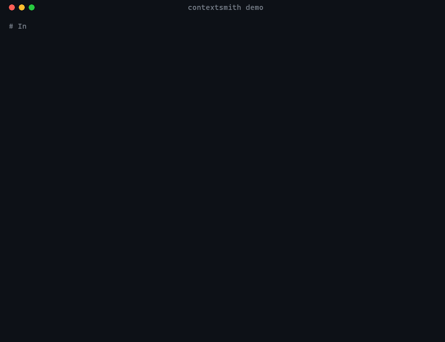
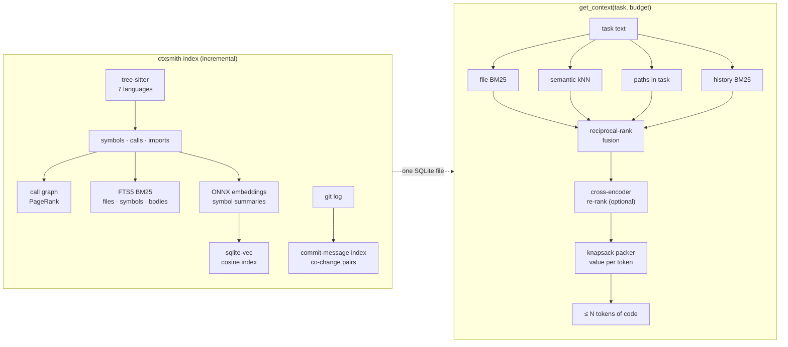

<div align="center">

# ContextSmith

**The best code context per token for coding agents.**

Hybrid retrieval (code graph + BM25 + local embeddings + git history) packed into a hard
token budget, served over MCP. Local, no API keys, MIT.

[](https://github.com/RahulSankhla312/contextsmith/actions/workflows/ci.yml)
[](https://pypi.org/project/contextsmith/)
[](pyproject.toml)
[](LICENSE)



</div>

Coding agents waste most of their context window on the wrong code: they grep, open whole
files, and run out of room before they reach the function that needs the fix. ContextSmith
answers one question as well as possible: **given this task and N tokens, what code should
the agent read?**

```bash
pipx install "contextsmith[semantic]"     # or: pip install "contextsmith[semantic]"
cd your-repo
ctxsmith index                             # seconds; incremental afterwards
ctxsmith context "Coupons are applied twice at checkout" --budget 4000
ctxsmith mcp-config claude                 # prints the one-line Claude Code setup
```

## Results

<!-- RESULTS -->

## How it works



**One SQLite file per repository** holds everything: files, symbols, call and import edges,
three FTS5 indexes, git statistics, team notes, and the vector index (a `vec0` virtual table
from [sqlite-vec](https://github.com/asg017/sqlite-vec); a numpy fallback runs where SQLite
can't load extensions).

**Retrieval (RAG).** Each signal produces its own ranked list of files; reciprocal-rank fusion
combines them, so no single noisy signal dominates:

| Signal | What it catches |
|---|---|
| BM25 over whole files (`camelCase`/`snake_case` split, paths weighted up) | exact vocabulary |
| Semantic kNN over symbol summaries (`BAAI/bge-small-en-v1.5`, ONNX, CPU) | the same idea in different words |
| Paths named in the task (tracebacks, "in `foo/bar.py`") | explicit pointers |
| BM25 over each file's commit messages | "this was touched for a similar bug before" |
| Co-change, call-graph neighbours, PageRank, exact-name mentions | available as weights; off by default because the benchmark showed they hurt *file* ranking |

The weights come from a grid search (`bench/tune.py`) on 89 SWE-bench Lite issues from 8
repositories and were then checked on Django, which tuning never saw.

**What gets embedded, and why.** Not whole files and not raw chunks: one short summary per
function or class — path, qualified name, signature, first docstring sentence. On a laptop
CPU this is ~30x cheaper than embedding bodies, and it is what identifies "which function is
this about". Vectors are cached by content hash, so a function that didn't change is never
embedded twice — across re-indexes and across git checkouts. Test files are skipped.

**Optional re-rank.** `--rerank` re-scores the top 20 files with a cross-encoder
(`ms-marco-MiniLM-L-6-v2`) and fuses that with the first-stage order.

**Packing.** Candidates are function bodies (matched by name, docstring and body text),
class outlines and file outlines. A greedy knapsack takes the best value per token,
discounts repeats from one file, and enforces the budget on the final rendered text, so the
answer is never over budget.

**Always fresh.** Re-indexing compares file size and mtime before reading anything, so an
unchanged repository re-indexes in milliseconds; the MCP server does this before answering,
so the agent never reads a stale index.

## Use it from your agent (MCP)

`ctxsmith mcp-config <client>` prints the exact snippet for your machine.

**Claude Code**

```bash
claude mcp add contextsmith -- ctxsmith serve --path /path/to/repo
```

**Cursor, Windsurf and other clients** (`mcp.json`):

```json
{
  "mcpServers": {
    "contextsmith": { "command": "ctxsmith", "args": ["serve", "--path", "/path/to/repo"] }
  }
}
```

**Codex** (`~/.codex/config.toml`):

```toml
[mcp_servers.contextsmith]
command = "ctxsmith"
args = ["serve", "--path", "/path/to/repo"]
```

| Tool | Returns |
|---|---|
| `get_context(task, budget_tokens, rerank)` | the best code for the task, packed to the budget |
| `search(query)` | ranked functions and classes |
| `find_symbol(name)` | where something is defined |
| `callers(name)` / `callees(name)` | one hop of the call graph |
| `impact(name)` | everything that transitively calls it: what a change could break |
| `related_files(path)` | files linked by code, and files that change together in git |
| `add_note(text, path, symbol)` | a decision or gotcha that later sessions should know |
| `overview()` | languages, size, central and most-changed files |
| `reindex()` | force an incremental re-index |

## CLI

| Command | What it does |
|---|---|
| `ctxsmith index [PATH] [--no-semantic]` | Index; incremental, embeddings on when the extra is installed |
| `ctxsmith context "task" -b 4000 [--rerank]` | Best context within a token budget |
| `ctxsmith rank "task"` | Ranked files, with the signals that found each |
| `ctxsmith search "query"` | Ranked functions and classes |
| `ctxsmith symbol / callers / callees NAME` | Navigate the call graph (`--json` for scripts) |
| `ctxsmith impact NAME` | What could break if NAME changes |
| `ctxsmith related FILE` | Files linked by code, and files that change together |
| `ctxsmith note add "text" --file F` | Remember a decision or gotcha |
| `ctxsmith overview` | Languages, size, central and most-changed files, semantic status |
| `ctxsmith serve` | MCP server over stdio |
| `ctxsmith mcp-config [claude\|cursor\|codex]` | Setup snippet for your agent |
| `ctxsmith bench --repos django/django` | Run the SWE-bench Lite benchmark yourself |

## Python API

```python
from contextsmith import Engine

eng = Engine("path/to/repo")
eng.index()
pack = eng.context("Fix the race when two users book the last seat", budget=6000)
print(pack.text, pack.tokens, pack.files)
eng.impact("reserve_seat")
```

## Configuration

| Variable | Default |
|---|---|
| `CTXSMITH_EMBED_MODEL` | `BAAI/bge-small-en-v1.5` (any [fastembed](https://github.com/qdrant/fastembed) text model, e.g. `jinaai/jina-embeddings-v2-base-code`) |
| `CTXSMITH_RERANK_MODEL` | `Xenova/ms-marco-MiniLM-L-6-v2` |
| `FASTEMBED_CACHE_PATH` | `~/.cache/contextsmith/models` |

The index lives in `<repo>/.contextsmith/` (git-ignored automatically). Without the
`semantic` extra everything still works, lexically.

## Languages

Python, JavaScript, TypeScript/TSX, Java, Go and Rust, parsed with tree-sitter.

## How it compares

Graphify, codebase-memory-mcp, GitNexus, Serena and Claude Context are good tools; this is
where ContextSmith differs:

| | ContextSmith |
|---|---|
| Answers "the best context for this task **in N tokens**" | ✅ budgeted packer, never over budget |
| Published, reproducible benchmark with baselines and ablations | ✅ `ctxsmith bench`, held-out repositories |
| Lexical + semantic + git history, fused | ✅ |
| Fully local, no API keys, one SQLite file | ✅ |
| Team notes pinned to code, surfaced in context | ✅ |
| Commercial-friendly licence | ✅ MIT |

## Roadmap

Multi-repo indexes, note staleness tracking, a file watcher, a graph view, a PR impact
report, and more languages. Ideas and benchmark-backed pull requests are welcome: see
[CONTRIBUTING.md](CONTRIBUTING.md).

## Licence

MIT
